# 蓝色雪境 · Blue Snow Valley

**雪谷生存探索 · AI伙伴 · 同机分屏合作 · 冰脊雪熊挑战**

柴火快用完时，远处的小屋就是下一段路的目标。风雪里留下两串脚印，你可以独自前行，也可以带上AI伙伴，或与身边的朋友一人一屏，分享补给、互相施救，一起走向温暖归途。

[**下载Windows游戏**](https://github.com/oo22432791-ctrl/blue-snow-valley/releases/latest) · [**V3实机介绍**](https://github.com/user-attachments/assets/d86ad7d1-ce50-4f0f-8381-c0d1952fa84e) · [**雪谷生活实录**](#先沿着雪谷走一段路) · [**操作与上手**](#操作与上手) · [**源码与构建**](#源码与构建)

## 先沿着雪谷走一段路

离开安全屋，沿着浅色小径走进林地。山坡把视线一段段展开，树影、路牌、营地与小屋成为认路的标记。你会路过开阔雪坡，也会走进枝干交错的林间，出发时的屋顶渐渐消失在身后。

下面这段**V2已有录像的连续60秒片段**，保留原速与脚步声，展示旅途中的实际行走。V3延续了这片雪谷及其基础探索体验。

https://github.com/user-attachments/assets/dfc6ae48-839e-4aa0-8a8e-25be8cfdb6bc

[查看V2林间漫游片段 · 60秒](docs/videos/legacy/v2-valley-walk.mp4)

| V2实录：林地与缓坡 | V2实录：路边营地 |
| --- | --- |
| 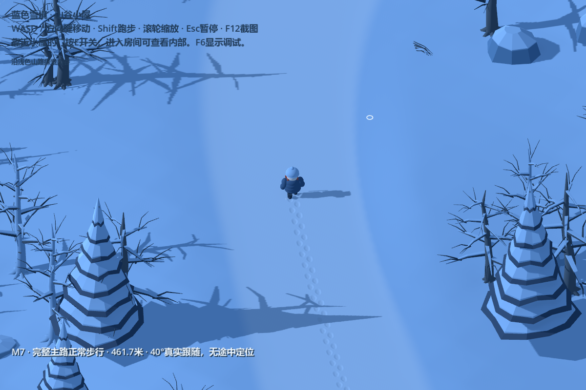 | 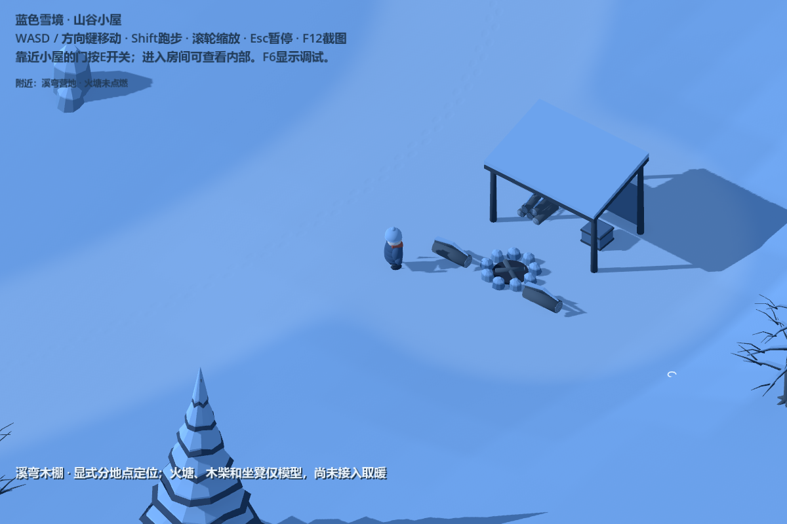 |

**素材标注**：本页新增的“V1／V2实录”均来自已有图片和录像，用于展示沿用至今的场景与基础玩法，保留录制时的界面。当前操作说明见游戏内“操作设置／说明”。

## 再看合作、机关与雪熊（V3）

四段V3游戏内录制，串起雪谷探索、双人雪球、石刻机关和雪熊战斗，保留游戏音效。

https://github.com/user-attachments/assets/d86ad7d1-ce50-4f0f-8381-c0d1952fa84e

[观看／下载完整实机视频（MP4，约40秒）](docs/videos/blue-snow-valley-v3-trailer.mp4)

<details>
<summary>展开12秒无声循环预览</summary>

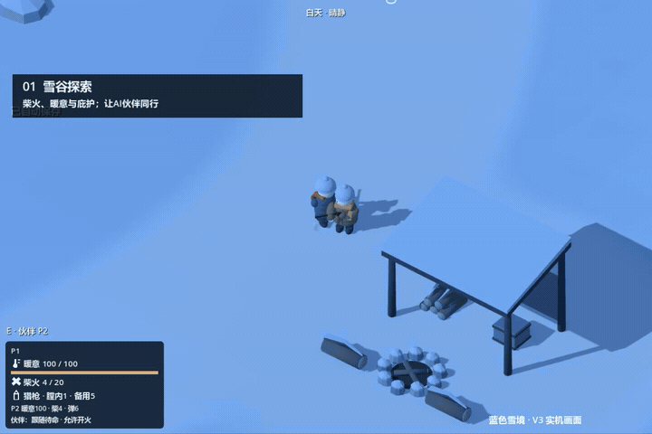

</details>

| 章节 | 你会看到 | 单段视频 |
| --- | --- | --- |
| 00:00 雪谷探索 | 带着伙伴移动、雪地足迹与独立暖意状态 | [探索与伙伴 · 10秒](docs/videos/forest.mp4) |
| 00:10 双人雪球 | 左右分屏、实际投掷、移动与命中计分 | [同机雪球 · 10秒](docs/videos/snowball.mp4) |
| 00:20 石刻转盘 | 场景中的实体石盘、图案与拉杆 | [转盘机关 · 10秒](docs/videos/puzzle.mp4) |
| 00:30 冰脊雪熊 | 巨大雪熊、合作射击、装填与攻击预警 | [雪熊战斗 · 10秒](docs/videos/boss.mp4) |

## 在雪谷里安顿下来

蓝白色山谷里有林地、营地和可以进入的小屋。出门拾柴、带足弹药，记住回屋取暖的路；天气与昼夜持续变化，背包里的补给会影响下一次出发。

每名角色都有自己的暖意、柴火和弹药。屋内外分别计算冷暖，两个人也可以进入不同的小屋。自由镜头支持旋转、俯仰和缩放，房屋与树木的遮挡按各自视角处理。

| 两座小屋，各自取暖 | 风雪中的探索 |
| --- | --- |
| 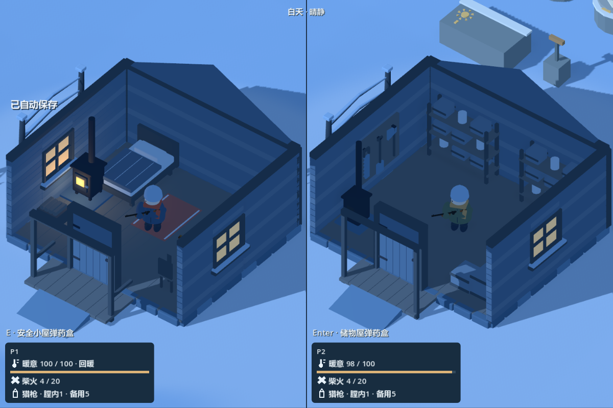 | 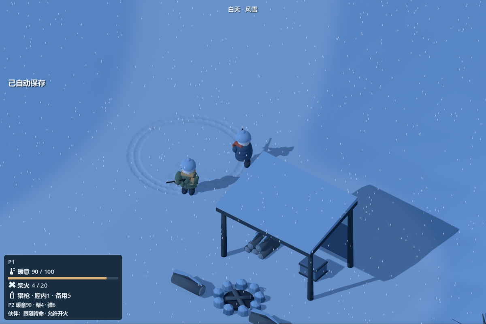 |

### 脚下的雪，会留下走过的痕迹

雪地深浅会影响移动和步态。走入深雪时，角色会更明显地抬腿；踩下去，雪面留下压痕，脚边扬起雪粉，也能听到随脚步变化的声音。站住、转身，再沿刚才的方向回看，路上已经多了一串足迹。

足迹会随时间逐渐被新雪覆盖，风雪中恢复得更快。雪面既提供行走的反馈，也让同一条路在不同时间呈现不同样子。

| V2实录：深雪中的抬腿与落脚 | V2实录：走过之后的足迹 |
| --- | --- |
| 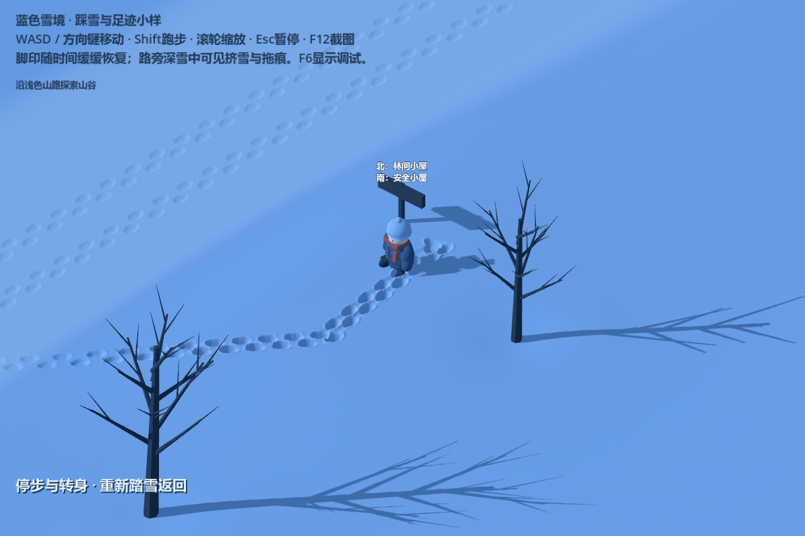 | 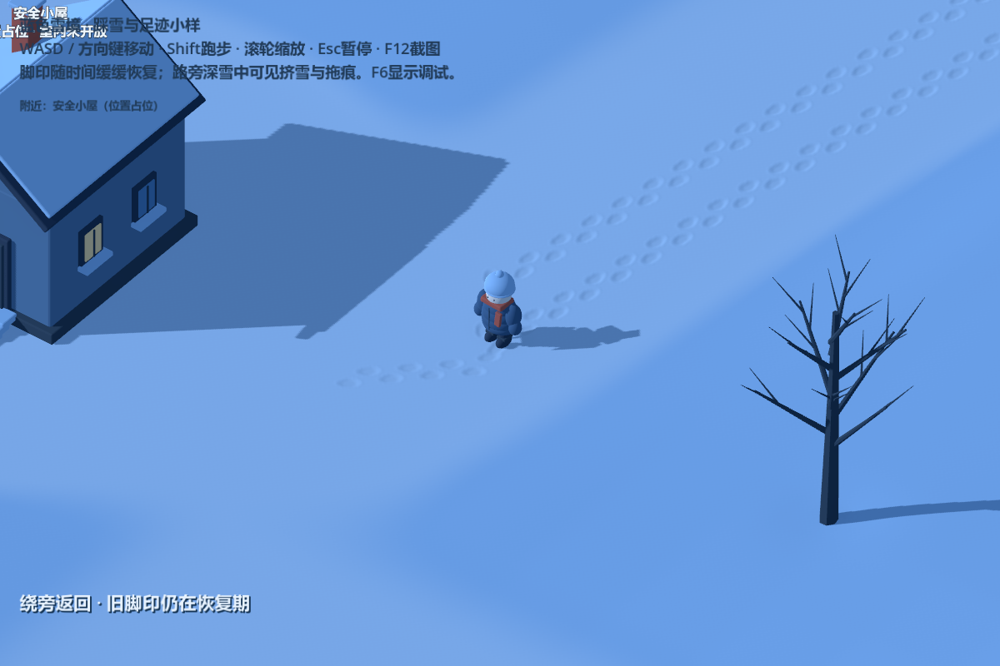 |

<details>
<summary>播放V2踩雪实录：脚步、压痕与雪粉（28秒）</summary>

https://github.com/user-attachments/assets/4a3bcb96-34fe-4325-ae0d-38d237202270

[查看踩雪片段](docs/videos/legacy/v2-snow-footsteps.mp4)

</details>

### 小屋与营地，是下一次出发的准备

三座小屋与沿途营地串起探索路线。小屋有可以开关的门和实际室内空间；进入后，屋顶与挡住角色的外壳会淡出，能看见炉子、家具和自己所处的位置。棚顶营地则提供途中歇脚的地方，火堆能让一段赶路暂时缓下来。

柴火既是背包里的资源，也是取暖的燃料。拾到枝柴后，可以带回屋内整理仓储、给炉子加柴，等暖意恢复，再决定继续上路还是留些补给给伙伴。一趟外出有了“出门—寻找—停留—回家”的节奏。

| V2实录：小屋门外 | V2实录：暖窗与室内空间 |
| --- | --- |
| 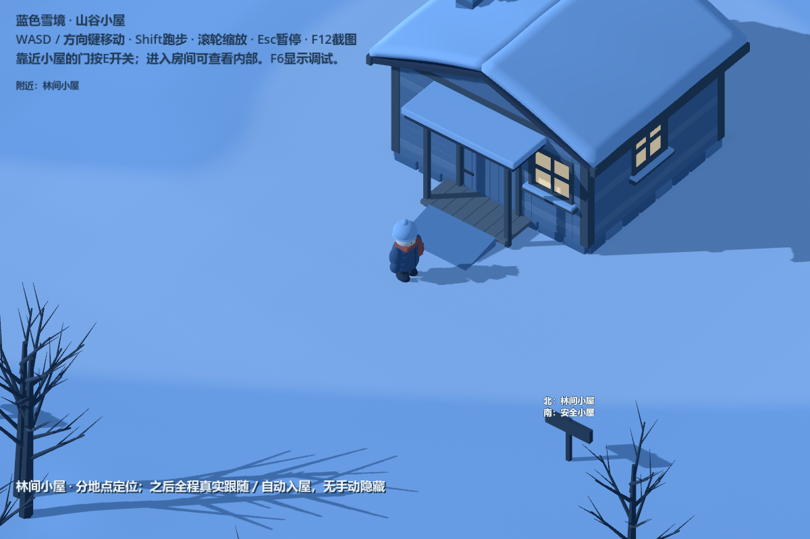 | 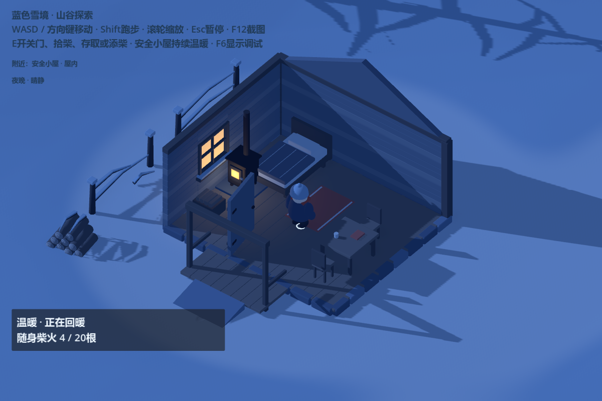 |

| V2实录：营地火堆 | V2实录：为屋内炉子添柴 |
| --- | --- |
| 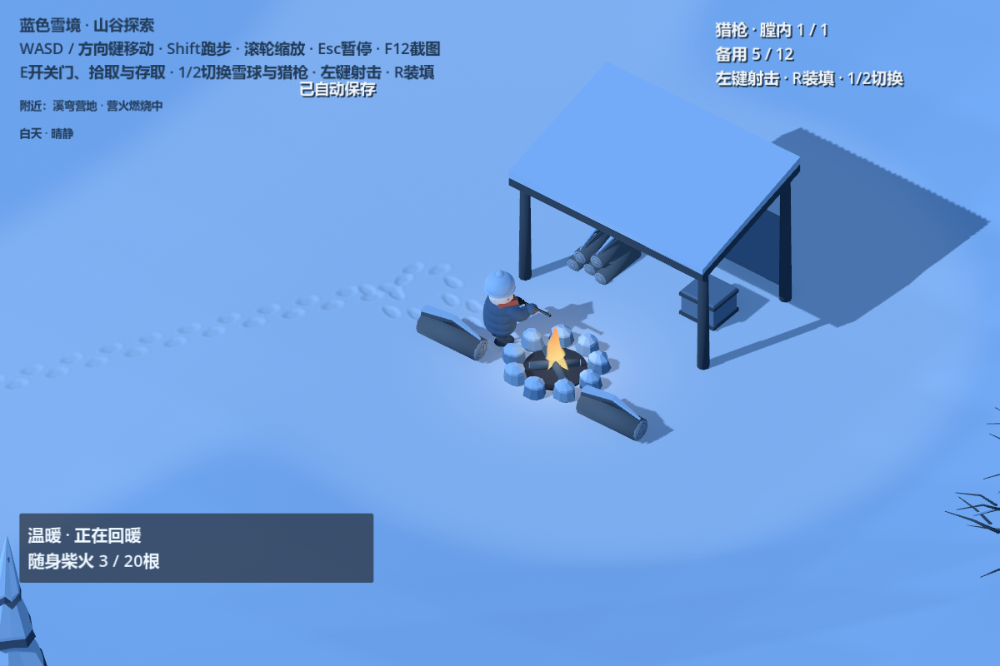 | 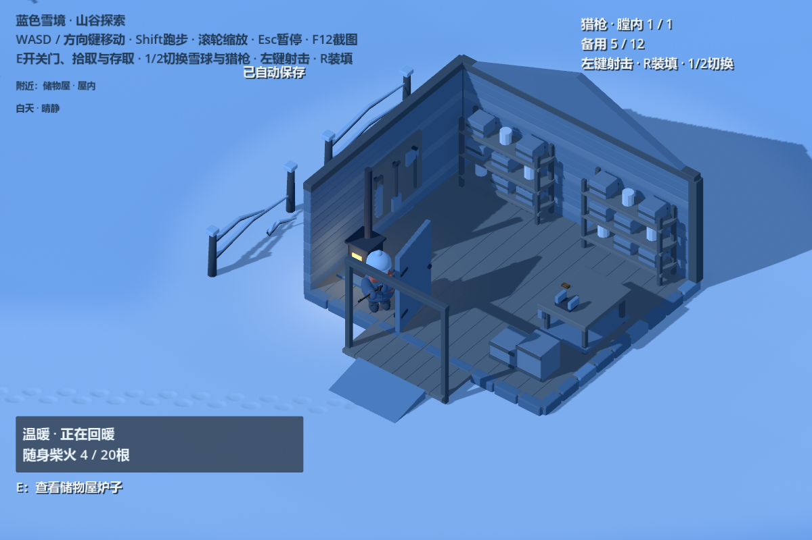 |

<details>
<summary>播放V2生活实录：拾柴、回屋与取暖（40秒）</summary>

https://github.com/user-attachments/assets/cb733594-b266-482f-9804-8230b81384ac

[查看拾柴与取暖片段](docs/videos/legacy/v2-gather-and-warm.mp4)

</details>

### 同一座雪谷，白夜与风雪带来不同氛围

白天的雪面与树影较为清晰，黄昏逐渐转向深蓝，夜晚的小屋暖窗更显眼。风雪渐强时，雪点随风偏移，脚下旧痕迹也更快被覆盖；走进屋内，屋顶会遮住落雪，户外风声随之减弱。

下方视频选自**V2既有天气录像的1倍速度部分**，展示夜间风雪、入屋与离屋；保留原录制中的时段切换和演示提示。

| V2实录：黄昏的蓝色光照 | V2实录：夜晚的风雪 |
| --- | --- |
| 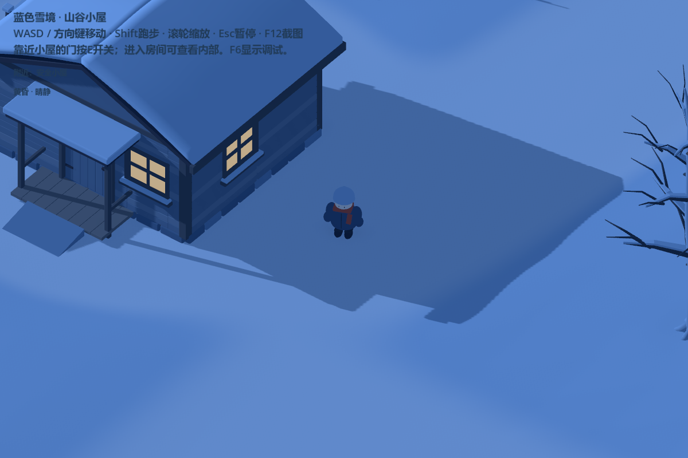 | 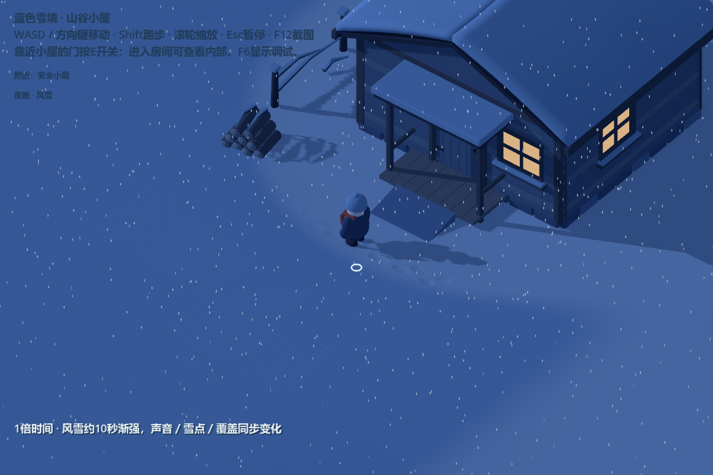 |

<details>
<summary>播放V2夜间风雪与室内遮蔽实录（34秒）</summary>

https://github.com/user-attachments/assets/b79491a9-963a-478d-91de-8b6d7544638a

[查看风雪与入屋片段](docs/videos/legacy/v2-night-weather.mp4)

</details>

### 林间还会遇见普通熊

通往山门的路上也有危险。看到普通熊时，可以先观察位置，选择绕行、撤回庇护处，或用携带的弹药应对。猎枪需要装填，追逐时消耗的暖意和补给，会影响你能走多远。

| V2实录：沿路拾到柴火 | V2实录：林中的普通熊 |
| --- | --- |
| 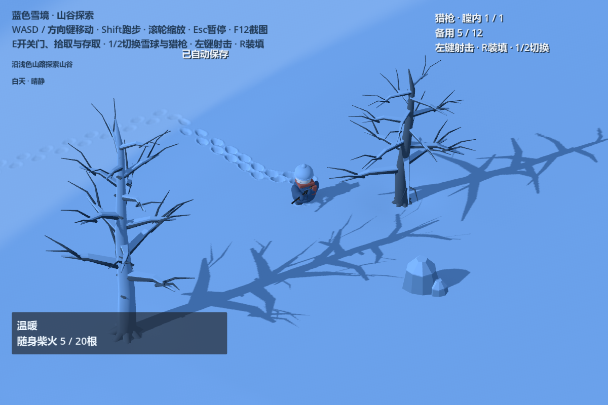 | 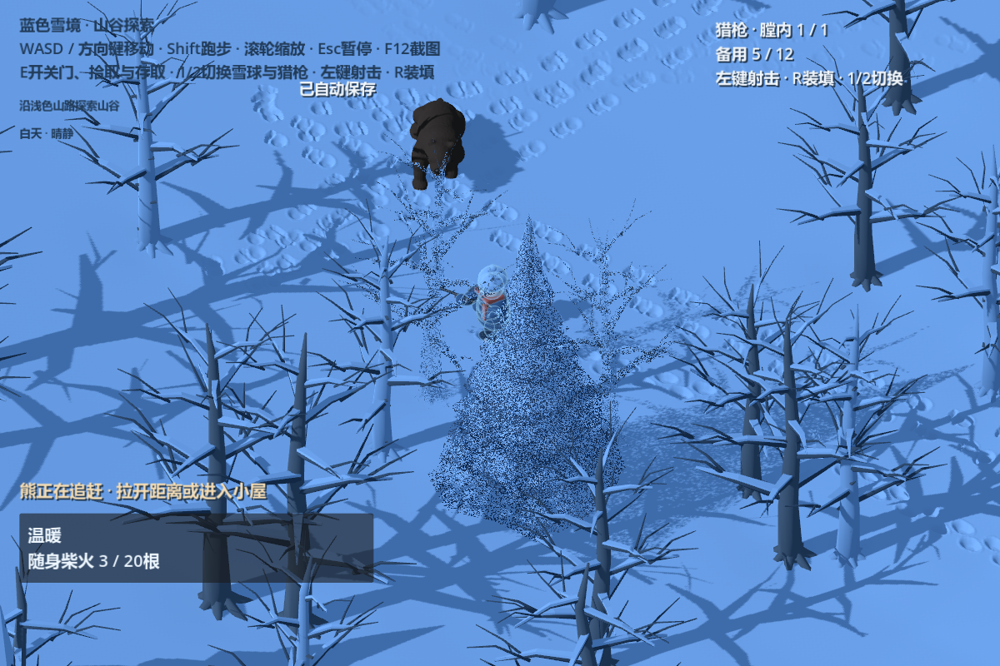 |

<details>
<summary>V2旅程实录：走了一圈，重新回到安全屋</summary>

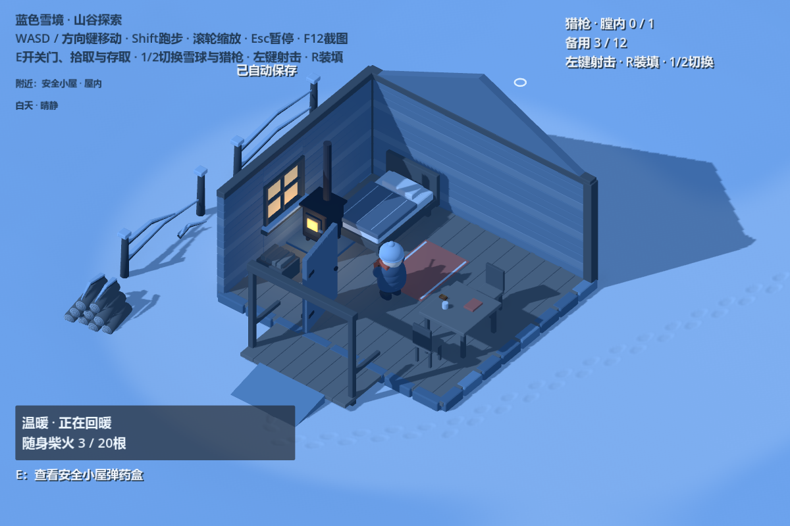

</details>

## 一个人，也有伙伴同行

选择AI护卫模式后，伙伴会沿实际路线跟随。你可以让他等待、协助拾柴，也可以切换允许开火或禁火；他的背包和弹药独立计算，射击同样需要装填。

靠近伙伴能够赠送柴火和备用弹药。倒地后，仍能行动的搭档可以靠近并持续施救；启用AI时，伙伴也会尝试赶来救援。

| 林间同行 | 靠近搭档施救 |
| --- | --- |
| 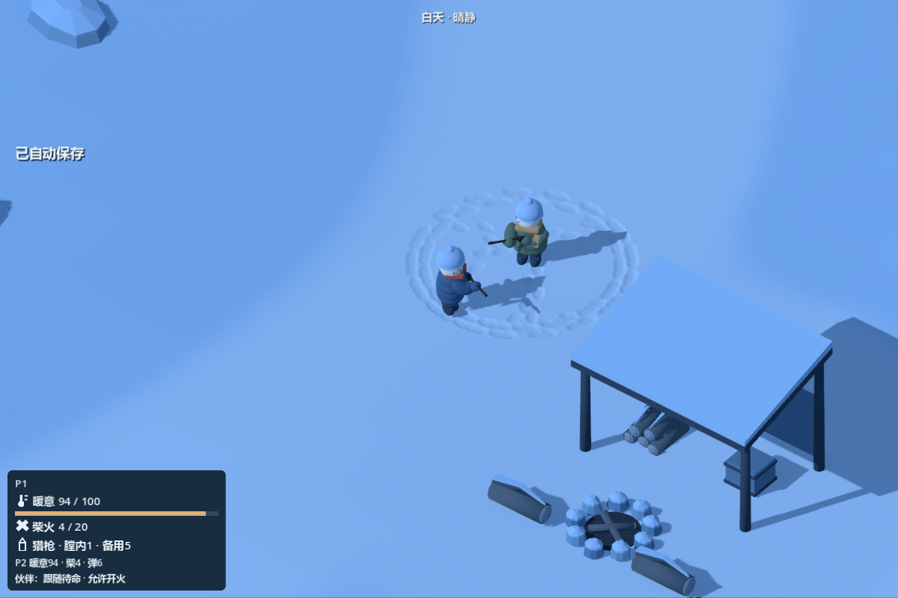 | 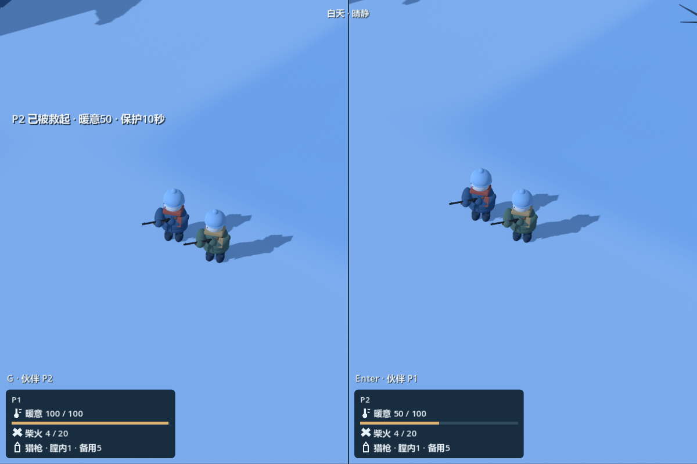 |

## 把另一半屏幕留给朋友

同机合作采用**左右分屏，P1在左、P2在右**。支持同一键盘分工操作，也支持P1键鼠加P2手柄。两名玩家拥有各自的镜头、瞄准、状态卡和交互菜单，可以分头找补给，也可以一起应对熊的威胁。

打开个人交互菜单时，另一人仍可继续探索；任一方打开全局暂停菜单，整个世界一起暂停。近距离交接物资、共同开火、救起同伴，让两个人的路线彼此照应。

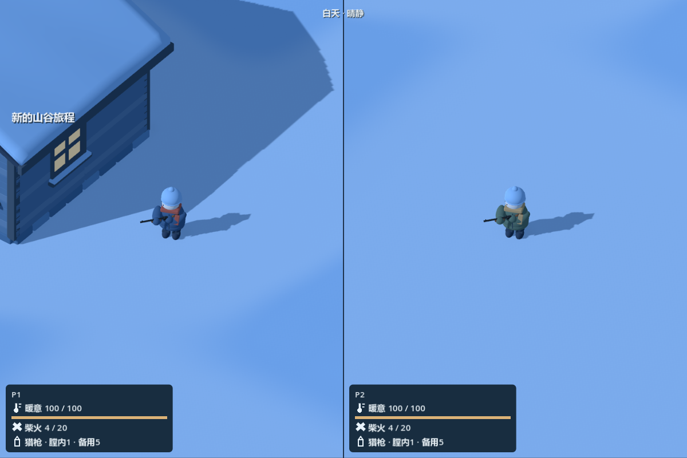

### 在空地上来一场雪球赛

双方同意后开局，**先到5分获胜**。雪球按真实碰撞计分，能移动躲避，也能主动选定对手辅助投掷；回合结束后可再次邀请。单人模式也能邀请AI伙伴一起玩。

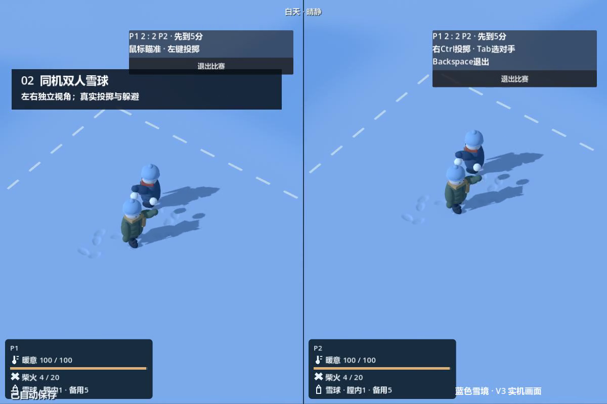

## 两条探索路线，一座山门

旅程中有两项可以任意顺序完成的事件。观察环境、找到线索，完成两项后，雪熊所在的山门才会开放。

| 石刻线索与三座转盘 | 阵风栈道与安全平台 |
| --- | --- |
| 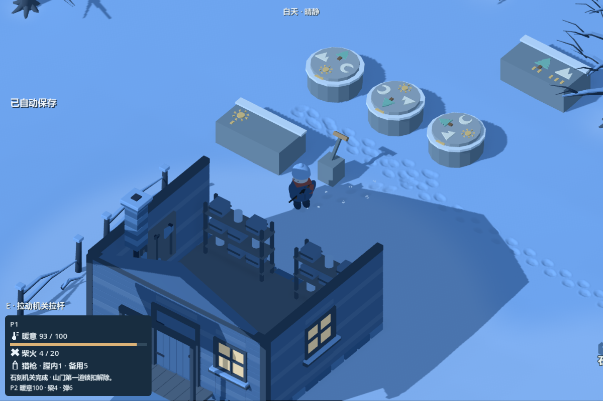 | 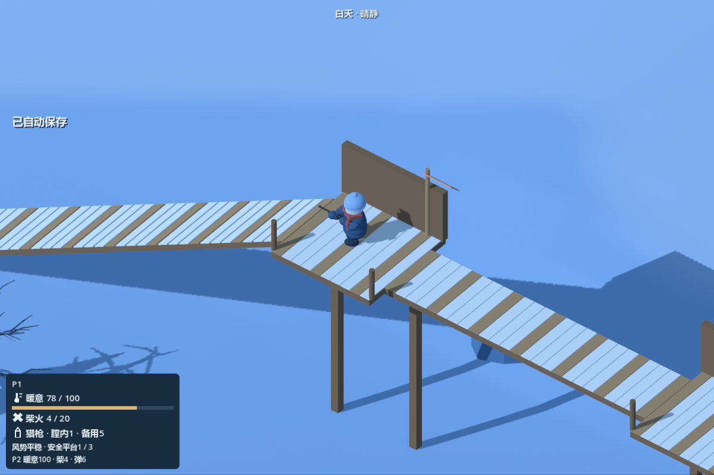 |

**石刻转盘**：找到两处图案线索，转动三座实体石盘，再拉下中央拉杆确认。每次交互都会实际转动石盘；尝试错误不会收取额外物资。

**阵风栈道**：看旗帜、等风歇，在两段栈道间利用掩体与中央平台停留。强风会侧推角色，失足后回到最近安全平台并损失暖意。AI伙伴也要沿相同的路等待和通过。

## 挑战冰脊雪熊

肩高约**4.8米**、体长约**9.6米**的巨大雪熊，背部隆起蓝白冰晶。冰壁错落的围院同时提供遮挡与绕行空间，两个视角会让你看见同一场战斗的不同侧面。

| 读懂预警，躲开冲撞 | 冰壁碎裂后的肩部弱点 |
| --- | --- |
| 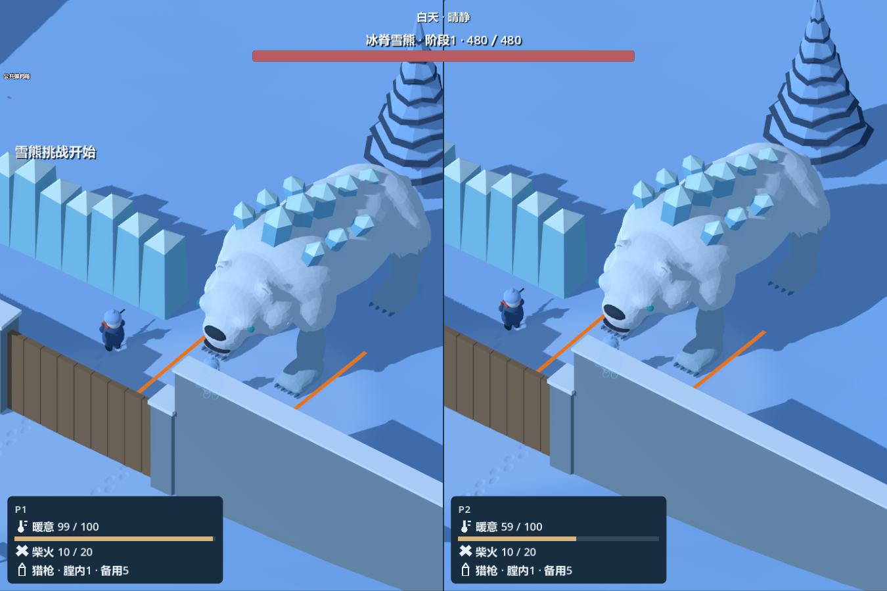 | 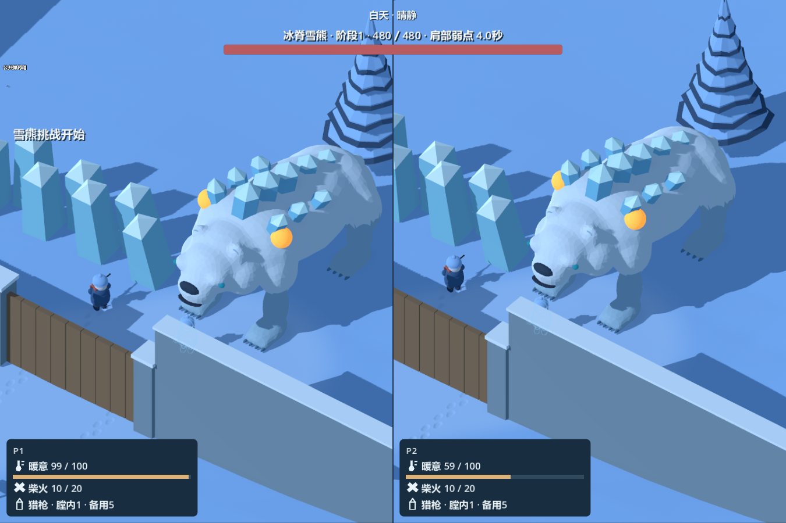 |

- **两阶段战斗**：前半场冲撞与拍地交替，后半场加入连续冲撞并加快节奏。
- **真实场地变化**：冲撞会撞碎冰壁并打开缺口，停步时短暂暴露肩部弱点；普通命中也能造成伤害。
- **补给与救援**：场内取弹需要停留，枪械使用真实弹药和装填，倒地搭档仍能被救起。
- **合作走位**：每次攻击前选择较近且可见的站立参战者，冲撞预警后锁定方向；搭档可以通过走位分担压力。

通关后可主动发起“回忆挑战”，再次尝试这场战斗；结束时恢复挑战前的世界和库存。

## 温暖归途

山门后的战斗告一段落，镜头回望雪谷、安全屋和一路同行的队伍。旅程结束后仍能继续探索，整理补给，再回到熟悉的小屋；也可以开始新旅程，并保留上一段旅程的归档。

| 回望安全屋 | 走过山门的队伍 |
| --- | --- |
|  | 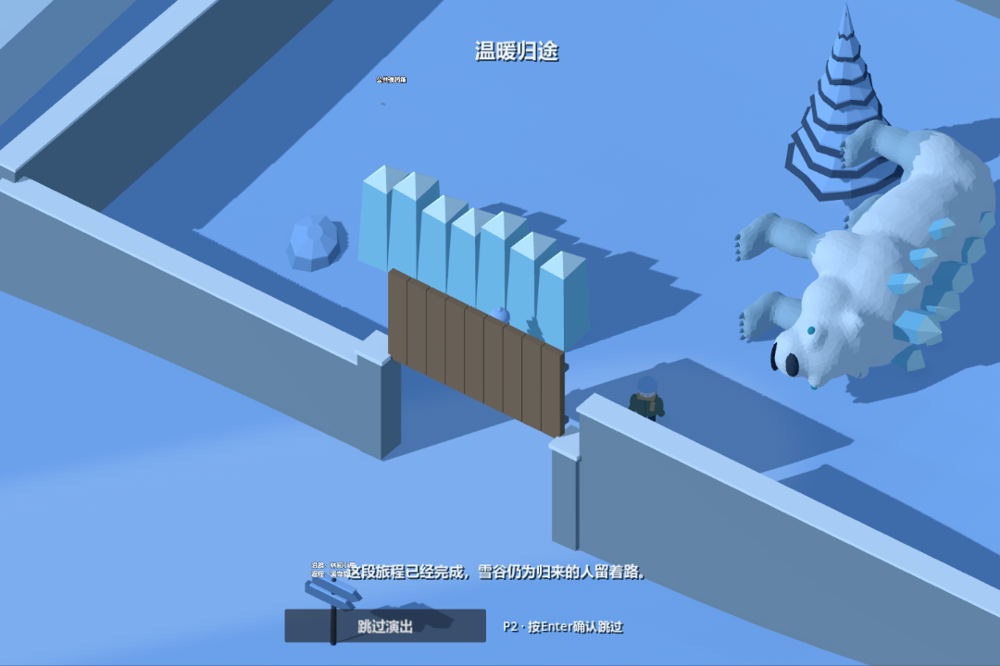 |

> 脚印会被新雪覆盖，一同走过的路不会。

## 从V1的一片雪地开始

最早的场景就有蓝色雪面、小屋、树影、散步的伙伴和雪球游戏。那时场地更紧凑，视角里可以同时看到小屋和两名角色，脚印一点点把原本平整的雪面变成玩过的地方。

这组**V1已有图片与录像**保留了最初的样子，也能看见今天这场旅程的起点：在雪里走一走，停下来，向伙伴丢一个雪球。

<details>
<summary>展开V1白夜图组与散步／雪球实录（24秒）</summary>

| V1原始场景：白天 | V1原始场景：夜晚 |
| --- | --- |
| 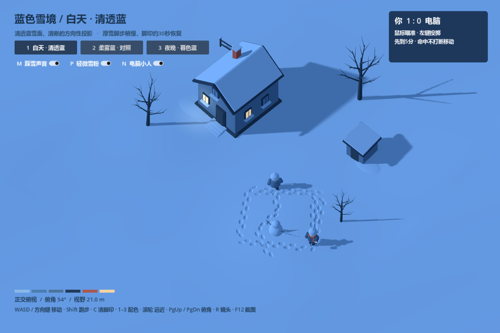 | 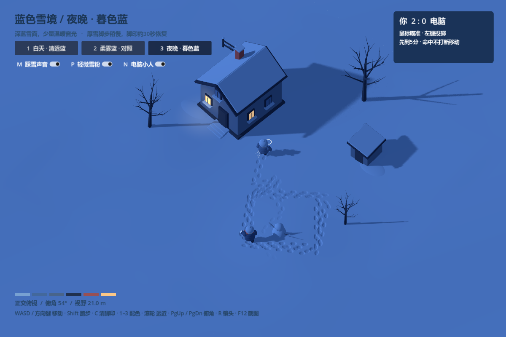 |

https://github.com/user-attachments/assets/e9fd6c12-aeef-477c-800f-c10af9c61156

[查看V1散步与雪球片段](docs/videos/legacy/v1-snow-walk.mp4)

</details>

## 操作与上手

首次游玩可以先在安全屋附近熟悉移动、镜头和交互，再带着柴火与弹药出发。靠近可交互对象时会显示当前按键，完整说明与改键入口位于主菜单、暂停菜单的**“操作设置／说明”**。

| 动作 | P1键鼠 | P2键盘 | P2手柄 |
| --- | --- | --- | --- |
| 移动／奔跑 | WASD／左Shift | 方向键／右Shift | 左摇杆／按下左摇杆 |
| 射击或投雪球 | 鼠标左键 | 右Ctrl | RT |
| 交互／救援 | E／按住E | Enter／按住Enter | A／按住A |
| 装填 | R | 句号 | X |
| 镜头 | 右键拖动、滚轮缩放、Home复位 | IJKL、U/O缩放、P复位 | 右摇杆、十字键上下缩放、按下右摇杆复位 |
| 选择目标 | 鼠标瞄准 | Tab | LB |
| 暂停 | Esc | Pause | Menu |

P1按Q打开伙伴指令。P1用1／2选择雪球／猎枪；P2键盘用逗号切装备，手柄用Y切装备。游戏动作可以改键，镜头速度、垂直反转与手柄死区也可独立保存。

<details>
<summary>查看手柄设置界面</summary>

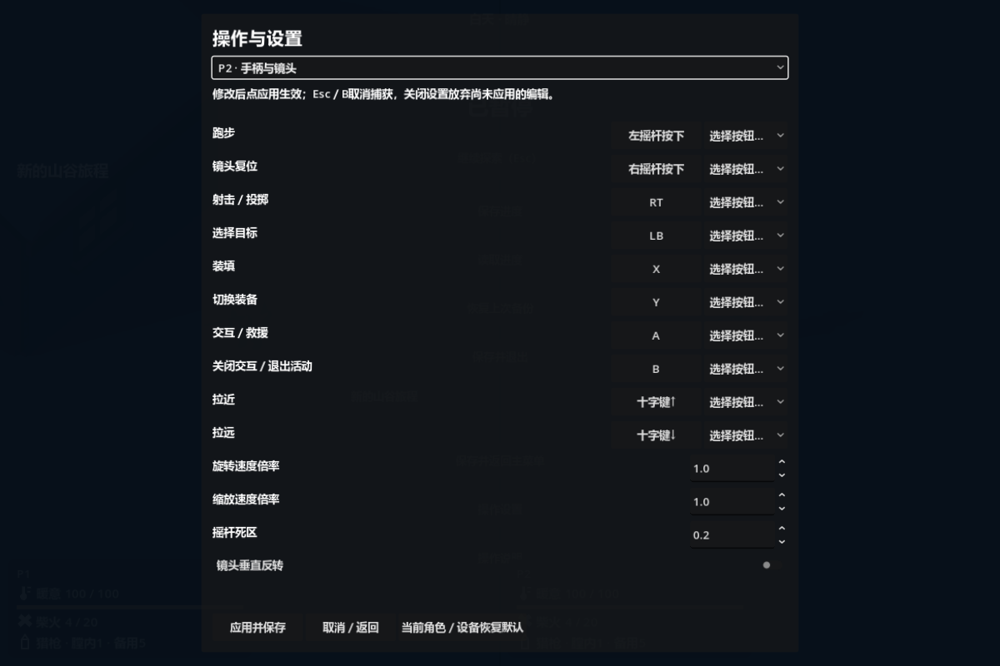

</details>

## 下载与运行

前往[Releases](https://github.com/oo22432791-ctrl/blue-snow-valley/releases/latest)下载 **BlueSnowValley_v3_Windows_x64.zip**，完整解压后双击 `BlueSnowValley_v3.exe`。EXE与同名PCK文件需要放在同一目录，无需安装Godot或Blender。

运行环境为Windows x64，使用Vulkan Forward+。默认窗口1200×800，内部总视口1440×960；同机模式保持左右分屏。

Release提供SHA256校验文件。游戏包不包含个人存档；Windows存档位于 `%APPDATA%\Godot\app_userdata\蓝色雪境 · 配色小样\saves\v3`，设置位于同级 `settings\v3`。退出游戏后可复制这两个目录备份。

## 源码与构建

可直接克隆本仓库，或使用 **Code → Download ZIP** 获取游戏工程和可编辑模型源。使用 **Godot 4.7.1** 打开 `project.godot`，默认进入V3。

```powershell
powershell -NoProfile -ExecutionPolicy Bypass -File .\run.ps1 -GodotPath 'Godot可执行文件完整路径'
```

保留V1／V2场景，可通过 `-Version V1` 或 `-Version V2` 显式运行。`source_art/blender/` 包含可编辑原生资产，模型编辑使用Blender 5.2；运行游戏无需Blender。

安装对应版本的Godot Windows导出模板后，使用 `Windows V3 Offline` 预设，或执行：

```powershell
powershell -NoProfile -ExecutionPolicy Bypass -File .\tools\build_windows_v3.ps1 -GodotPath 'Godot可执行文件完整路径'
```

<details>
<summary>下载包含制作工具与开发记录的完整源码分卷</summary>

在Release下载 `.part01` 至 `.part09`、`Source_Parts_Manifest.json` 和 `Combine-Source.ps1`，放入同一目录后运行：

```powershell
powershell -NoProfile -ExecutionPolicy Bypass -File .\Combine-Source.ps1
```

脚本会逐卷校验、合并完整ZIP，再核对完整ZIP的SHA256。

</details>
