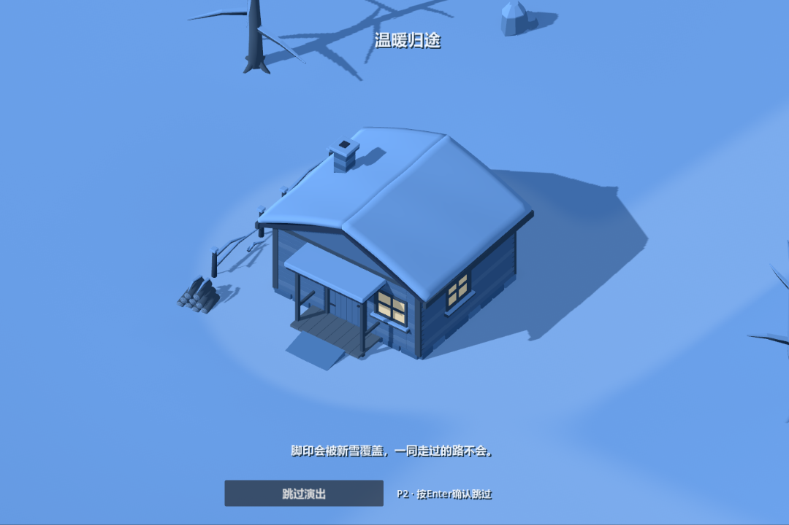
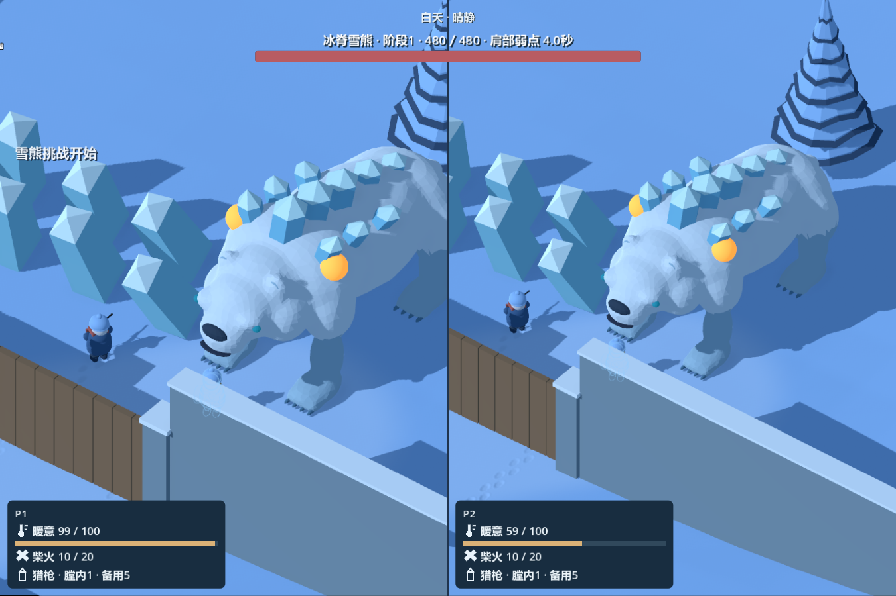

# 蓝色雪境 · Blue Snow Valley

在蓝白色雪谷里收集柴火、寻找庇护，与伙伴一起穿过风雪，挑战冰脊雪熊，走向温暖归途。



## 下载与运行

前往[Releases](https://github.com/oo22432791-ctrl/blue-snow-valley/releases/latest)下载 Windows x64 游戏包，完整解压后双击 `BlueSnowValley_v3.exe`。EXE 与同名 PCK 文件需放在同一目录，无需安装 Godot 或 Blender。

Release 同时提供完整源码分卷与 SHA256 校验文件。将 `.part01` 至 `.part09`、`Source_Parts_Manifest.json` 和 `Combine-Source.ps1` 下载到同一文件夹，执行下方命令即可校验并合并为完整源码ZIP：

```powershell
powershell -NoProfile -ExecutionPolicy Bypass -File .\Combine-Source.ps1
```

也可直接克隆本仓库，或使用 GitHub 的 **Code → Download ZIP** 获取游戏工程与可编辑模型源。游戏不附带个人存档。

## 游戏内容

- 单人独自探索、AI护卫伙伴，以及键盘或手柄同机左右分屏合作。
- 独立自由镜头、天气与昼夜、积雪脚印、暖意与取暖、补给和物资赠送。
- 猎枪战斗、倒地救援、伙伴指令与双人雪球游戏。
- 石刻转盘、阵风栈道、冰脊雪熊两阶段战斗与回忆挑战。
- 归途实景演出、旅程归档、存读档及可保存的按键与镜头设置。



## 操作

P1：WASD移动，鼠标瞄准，左键射击，右键拖动镜头，滚轮缩放，Home复位镜头，E交互，Q伙伴指令，Esc暂停。

P2键盘：方向键移动，IJKL转镜头，U/O缩放，P复位，右Ctrl射击，右Shift奔跑，Enter交互，句号装填，逗号切装备，Tab选目标，Pause暂停。

P2手柄：左摇杆移动／按下奔跑，右摇杆转镜头／按下复位，RT射击，LB选目标，X装填，Y切装备，A交互，B关闭菜单，十字键上下缩放，Menu暂停。

完整说明与改键入口在主菜单和暂停菜单的“操作设置／说明”。

## 从源码运行

使用 Godot 4.7.1 打开 `project.godot`，默认运行 V3。渲染使用 Vulkan Forward+；窗口默认1200×800，内部总视口1440×960。

```powershell
powershell -NoProfile -ExecutionPolicy Bypass -File .\run.ps1 -GodotPath 'Godot可执行文件完整路径'
```

保留 V1／V2 场景，可使用 `-Version V1` 或 `-Version V2` 显式运行。`source_art/blender/` 包含可编辑原生资产，编辑模型使用 Blender 5.2；运行游戏无需 Blender。

安装对应版本的 Godot Windows 导出模板后，可使用工程内的 `Windows V3 Offline` 预设，或执行：

```powershell
powershell -NoProfile -ExecutionPolicy Bypass -File .\tools\build_windows_v3.ps1 -GodotPath 'Godot可执行文件完整路径'
```

## 存档

Windows存档位于 `%APPDATA%\Godot\app_userdata\蓝色雪境 · 配色小样\saves\v3`，操作设置位于同级 `settings\v3`。退出游戏后可复制这两个目录备份。
